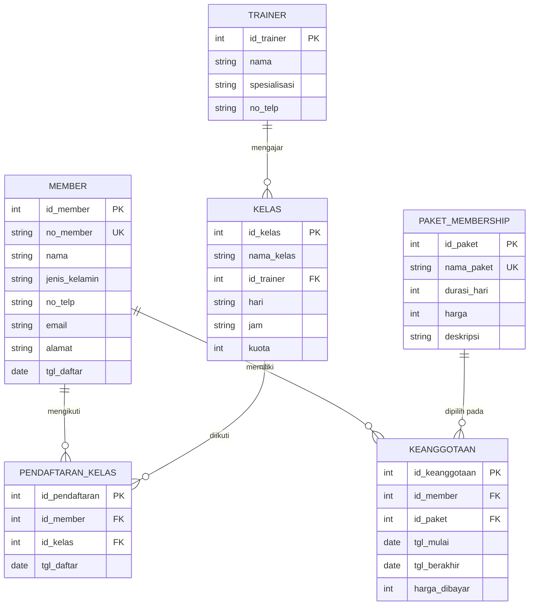

# ERD - Gym Membership Management

Salin blok Mermaid di bawah ke https://mermaid.live untuk membuat gambar ERD
(atau pakai ekstensi "Markdown Preview Mermaid Support" di VS Code).

## Relasi
| Relasi | Kardinalitas | Keterangan |
|---|---|---|
| MEMBER - KEANGGOTAAN | 1 : N | Satu member bisa daftar/perpanjang berkali-kali |
| PAKET_MEMBERSHIP - KEANGGOTAAN | 1 : N | Satu paket dipilih oleh banyak transaksi |
| TRAINER - KELAS | 1 : N | Satu trainer mengajar banyak kelas |
| MEMBER - KELAS | M : N | Dihubungkan oleh tabel PENDAFTARAN_KELAS |

## Aturan Bisnis
- `tgl_berakhir` dan `harga_dibayar` dihitung otomatis dari paket yang dipilih.
- Status keanggotaan otomatis: Aktif, Segera Berakhir (<= 7 hari), Kedaluwarsa.
- Member hanya dapat mendaftar kelas jika keanggotaannya masih aktif.
- Pendaftaran kelas ditolak jika kuota sudah penuh.
- Data induk (member, paket, trainer, kelas) yang masih dipakai tidak bisa dihapus.
